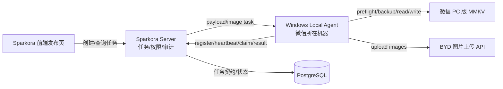

# Design — BYD 王朝小程序本地推送集成

## Architecture



## Core Decision

1. Server 不写本地 MMKV，不检测用户本机微信进程。
2. Local Agent 是唯一 MMKV 执行器。
3. Edge 插件后续可作为 Agent 的 UI 壳，但不作为第一阶段依赖。
4. 油猴脚本不纳入正式方案。
5. 推送前必须本地预检，写入前必须备份，写入后必须重新解析验证。

## Runtime Contract

### Push Job State Machine

```text
PENDING
  -> CLAIMED
  -> RUNNING
  -> SUCCESS | FAILED
```

Agent 离线时不创建新 PENDING 任务；创建任务必须检查 Agent 当前可推送状态。

### Local Preflight

Agent 返回的预检结果至少包含：

```json
{
  "agentVersion": "0.1.0",
  "osOk": true,
  "configOk": true,
  "mmkvDirOk": true,
  "mmkvMainFileOk": true,
  "mmkvCrcFileOk": true,
  "fileParseOk": true,
  "readableOk": true,
  "writableOk": true,
  "wechatClosed": true,
  "backupDirOk": true,
  "diskSpaceOk": true,
  "ready": true,
  "issues": []
}
```

Server 只信任心跳附近的预检结果，但执行前 Agent 必须再次预检。

### Push Result

```json
{
  "jobId": 123,
  "status": "SUCCESS",
  "draftId": "...",
  "draftCount": 18,
  "publishedAt": "...",
  "uploadedImageUrls": ["..."],
  "preflightSummary": {},
  "error": null,
  "logsSummary": {}
}
```

## Implementation Order

1. 数据模型与 Agent/push job API。
2. Local Agent 本地预检与配置。
3. 图片压缩/上传。
4. MMKV 读取、备份、追加写入、重新解析。
5. 发布页渠道 UI。
6. 联调与安全验收。

## Safety Rules

- 不自动杀微信进程。
- 任何预检失败不写 MMKV。
- 备份失败不写 MMKV。
- 图片上传失败不写 MMKV。
- BYD 与公众号发布字段完全隔离。
- Agent 不执行 Server 颁发的任意命令。
